<p align="center">
  
</p>

<h1 align="center">IRIS</h1>

<p align="center"><b>Identity-Verified Record Intake System</b><br>
The right record, from the right person, about the right patient.</p>

<p align="center">
  <b>6/6</b> audit steps logged&nbsp;·&nbsp;<b>3/3</b> misdeliveries caught&nbsp;·&nbsp;<b>0/17</b> jury-style documents filed to the wrong patient&nbsp;·&nbsp;<b>0</b> patient data in 24 emails and 5 SMS&nbsp;·&nbsp;<b>0</b> HL7 validator errors
</p>

A doctor in a closed Matrix network asks someone outside it for a document. IRIS gets it in through a one-time
link, proves it comes from the right person and is about the right patient, and files it as valid FHIR R4:
automatically, audited, with the doctor told in Matrix.

AIM Healthcare Hackathon Vienna 2026, Track 2 (Health Data Interoperability, partner FTAPI). Synthetic data only.

---

## A Thursday morning in Vienna

**Dr. Lena Hofer** has a patient on tomorrow's list: Maria Beispiel, 65, due for a procedure. One piece is
missing: her coagulation values, sitting in a lab across town, outside the clinic's network. Today that means a
phone call, a fax, and someone typing numbers in by hand. And one wrong letter in an email address sends a
patient's name and results to a stranger.

With IRIS, she types one sentence into her clinic chat:

> *"Please ask Dr. Eva Brandl at eva.brandl@labor-kanal.example for the coagulation values of Maria Beispiel, born 12 March 1961, before her procedure."*

IRIS turns it into a request card, checks the address, finds the patient on the clinic's FHIR server and waits
for her OK. One click, and it's on its way.

### Across town: a link that gives nothing away

**Dr. Eva Brandl**, lab physician, gets an email with one link. No patient name, no birth date, no document
type: just "Klinikum Beispielstadt has sent you a secure document request." She opens it on her phone.

<table>
  <tr>
    <td align="center" width="25%">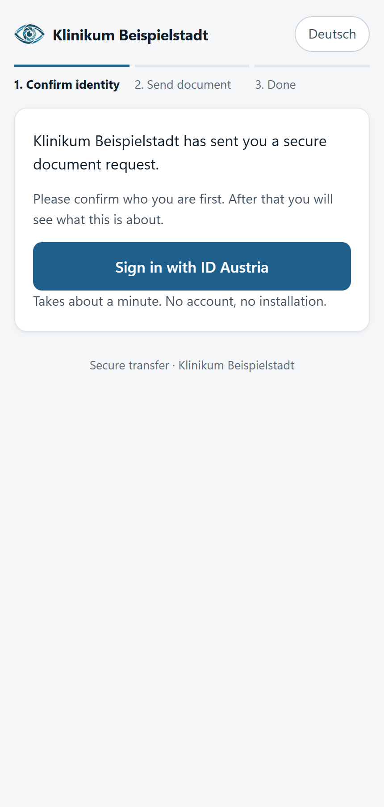</td>
    <td align="center" width="25%">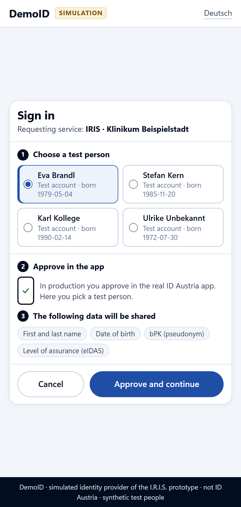</td>
    <td align="center" width="25%">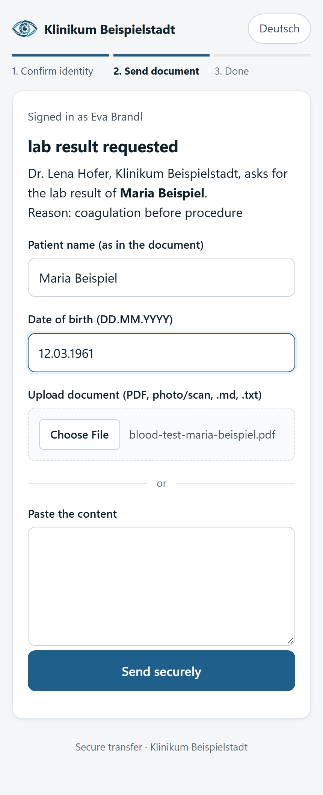</td>
    <td align="center" width="25%">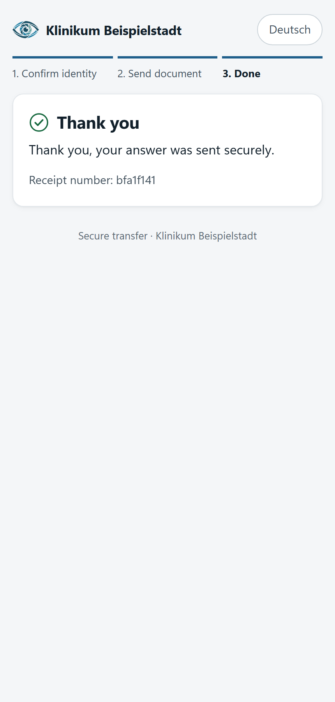</td>
  </tr>
  <tr>
    <td align="center"><b>1 · The link</b><br><sub>Nothing about the patient yet. No account, no install.</sub></td>
    <td align="center"><b>2 · Who are you?</b><br><sub>Electronic ID (simulated here as <i>DemoID</i>; ID Austria in production).</sub></td>
    <td align="center"><b>3 · Only now: the request</b><br><sub>Patient and document appear after the name matches. She drops in the PDF.</sub></td>
    <td align="center"><b>4 · Done</b><br><sub>A receipt number, nothing else. No account was created.</sub></td>
  </tr>
</table>

### Back at the clinic: coded, validated, signed

Seconds later the values are in Maria's record: every value a FHIR Observation with its LOINC code, unit and
reference range, out-of-range values flagged, the original PDF attached, and a Provenance that says exactly who
sent it and how their identity was checked. Dr. Hofer gets a message in her chat with the link.

<p align="center">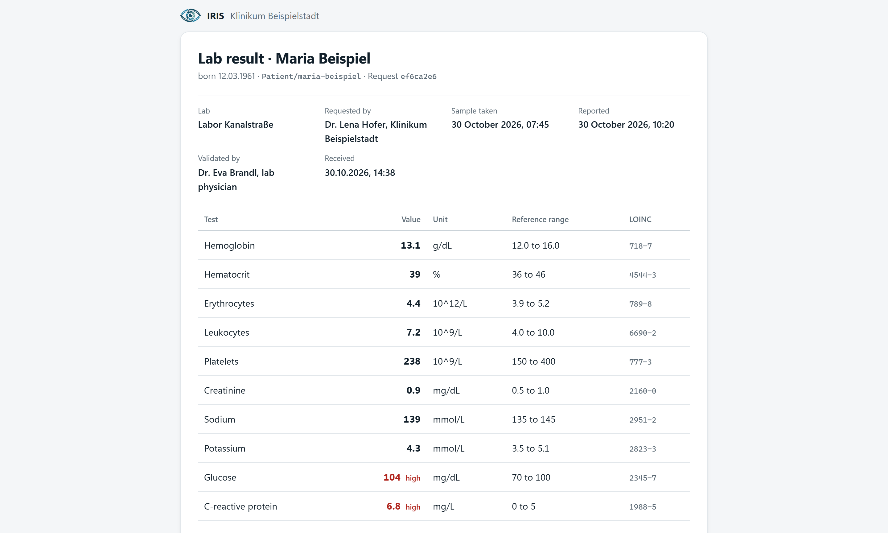</p>

### Three things that go wrong in real life, and don't here

| What happens | What IRIS does |
|---|---|
| **One wrong letter in the address.** `eva.brandl@labor-kanaI.example`: a capital I instead of an l. | The draft card warns *before* anything is sent: *the domain looks like labor-kanal.example but isn't the same ("I" instead of "l").* |
| **The email gets forwarded.** A colleague, Karl, opens the link. | His electronic ID says he's not Dr. Brandl. He sees nothing, can't answer, and Dr. Hofer is told. |
| **The wrong patient's result is uploaded.** Max Beispiel instead of Maria. | A calibrated record-linkage check compares the requested patient, the typed patient and the document. It doesn't match: nothing is filed, and the other patient is never named. |

<table>
  <tr>
    <td align="center" width="50%">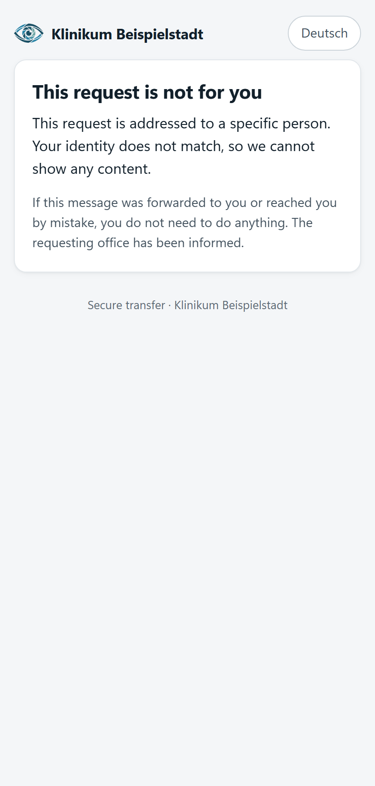</td>
    <td align="center" width="50%">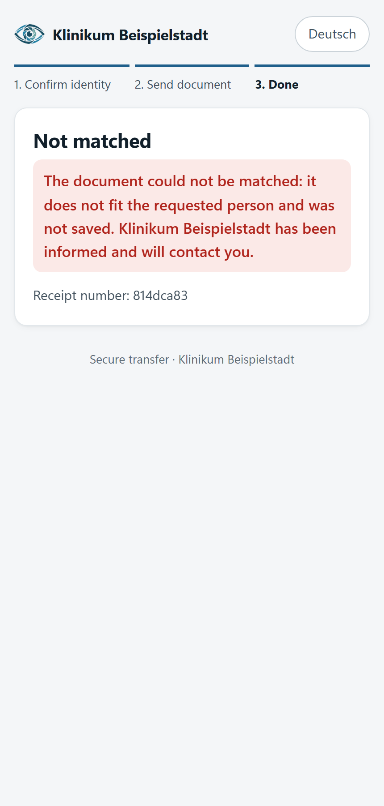</td>
  </tr>
  <tr>
    <td align="center"><b>Forwarded link</b><br><sub>Wrong person, nothing revealed.</sub></td>
    <td align="center"><b>Wrong patient</b><br><sub>Never filed, never named.</sub></td>
  </tr>
</table>

### Every step on record

Request sent, link opened, identity checked, answer sent, answer filed, misdelivery caught: each step is written
to an append-only log where every row carries the hash of the row before it. Change or delete an entry, and the
chain breaks from that point.

<p align="center">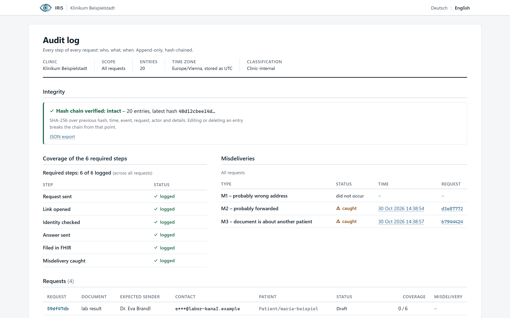</p>

**No retyping. No fax. No findings in a stranger's inbox.** And all of that in the blink of an eye.

---

## Under the hood

The full picture is in the **[IRIS System Atlas](docs/system-atlas.html)** (download and open it in a browser):
containers and trust zones, the tool stack, the design patterns, the request lifecycle, timings, and the data model.

<p align="center">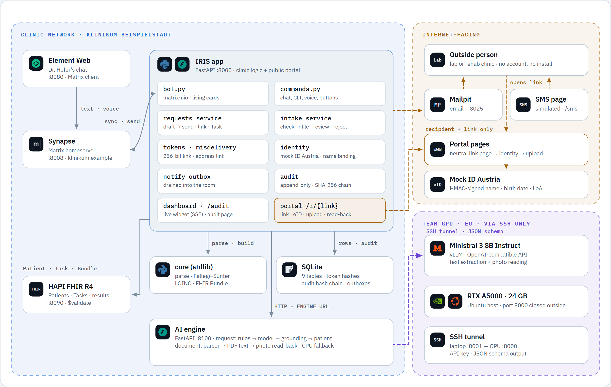</p>

**Everything that sees patient data runs inside the clinic.** The internet only gets an opaque link and a neutral
page; the GPU only gets text through an SSH tunnel.

<details>
<summary><b>Design patterns: models read, rules decide</b></summary>
<br>
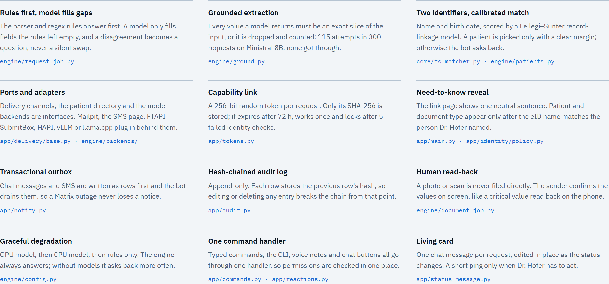
</details>

<details>
<summary><b>Request lifecycle and audit events</b></summary>
<br>
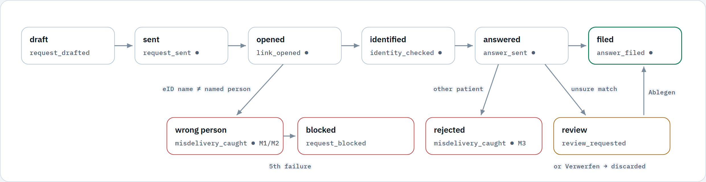
</details>

<details>
<summary><b>Time per step</b></summary>
<br>
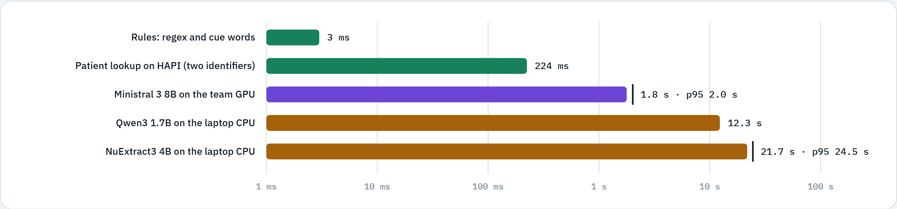
</details>

<details>
<summary><b>FHIR R4 resources filed for one lab answer</b></summary>
<br>
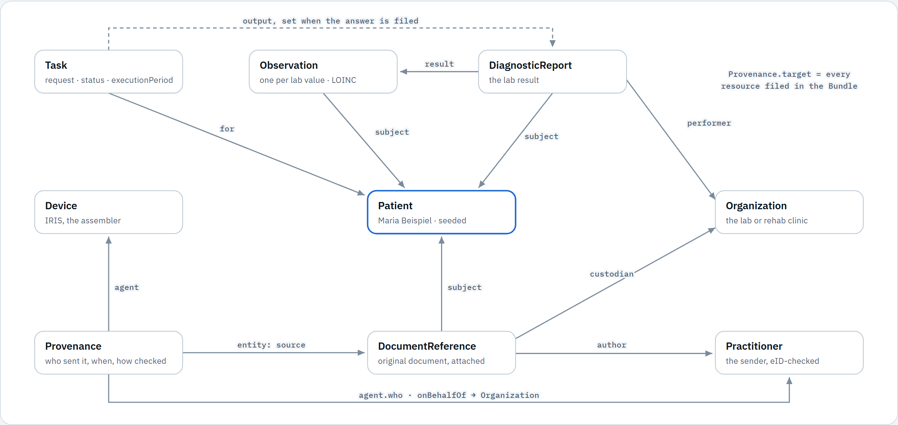
</details>

<details>
<summary><b>What crosses each boundary</b></summary>
<br>
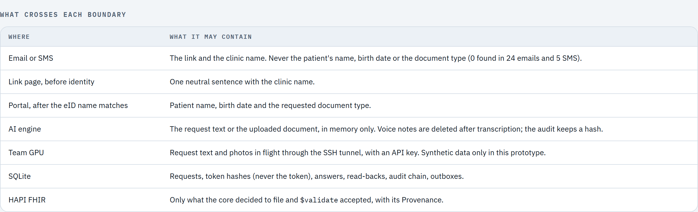
</details>

---

## Run it

Needs Docker, [uv](https://docs.astral.sh/uv/), Java 17+ (only for the HL7 validator).

```
make install      # python deps
make test         # unit + end-to-end flow tests, no Docker
make up           # Synapse + Element + HAPI + Mailpit + app, users/room/patient set up
```

| What | Where |
|---|---|
| Element (Dr. Hofer) | http://localhost:8080 — user `lena.hofer`, password in `.env` |
| Mailpit (emails) | http://localhost:8025 |
| SMS (simulated) | http://localhost:8000/sms |
| Audit log | http://localhost:8000/audit |
| HAPI FHIR | http://localhost:8090/fhir |

In the room, write the request in plain English or German, for example *"Please ask Dr. Eva Brandl at
eva.brandl@labor-kanal.example for the coagulation values of Maria Beispiel, born 12 March 1961"*, and confirm the
card (a patient is picked only with two identifiers: name and birth date). The exact command
form also works: `!anfrage labor "Dr. Eva Brandl" eva.brandl@labor-kanal.example Patient/maria-beispiel Grund: coagulation before procedure`,
then `!senden <id>` (`!anfrage` = request, `labor` = lab, `Grund` = reason, `!senden` = send).

The portal accepts PDF (read from its text layer), Markdown or plain-text files, pasted text, and photos or scans
(those are read back to the sender for confirmation, never filed straight away).

Browser end-to-end test of the portal (request 1 timed, request 2 via `/sms`, M1–M3), JSON on stdout and in `var/e2e.json`:

```
uv run python scripts/e2e.py            # against the running stack (make up)
uv run python scripts/e2e.py --local    # no Docker: app in-process, fake HAPI
```

It needs a Chromium: `uv run playwright install chromium`, or a system `chromium` on the PATH.

## Architecture
IRIS has a deterministic core, a FastAPI service around it, and five off-the-shelf services.

**Models and services.** Every decision is deterministic or statistical: patient matching is a calibrated record-linkage model (Fellegi–Sunter, weights estimated on synthetic labelled pairs, `core/weights.json`); parsing of the scenario format, LOINC checks, FHIR building and the identity policy are rules. Models only *read* (see [AI engine](#ai-engine)): Dr. Hofer's typed or spoken request, and answers that arrive as PDF, scan or phone photo. They run self-hosted on one GPU (vLLM), every value they return must be a slice of the input, and the rules above still decide. Services we run but did not write: Synapse, Element Web, HAPI FHIR R4, Mailpit, SQLite.

| Component | Built / used | Role |
|---|---|---|
| `core/` (stdlib only) | built | `parse_doc.py`: Markdown parser (EN + DE). `fs_matcher.py`: Fellegi–Sunter check of the patient, three ways: requested ↔ typed ↔ document. `loinc.py`: check digit and code/name consistency, never invents a code. `fhir_build.py`: transaction Bundle (lab: Observation per row with LOINC, UCUM, reference range, interpretation; DiagnosticReport; DocumentReference with the original; Provenance. Rehab report: DocumentReference LOINC 18842-5 + Provenance). Provenance agents: the verified sender and our Device. `intake.py` returns the decision file / review / reject. |
| `app/` (FastAPI) | built | Public portal and clinic-side logic: `commands.py` (doctor commands, shared by bot and CLI), `bot.py` (matrix-nio), `requests_service.py` (draft → send: single-use link, channel, FHIR Task), `misdelivery.py`, `intake_service.py` (core decision → HAPI `$validate` → transaction → Task completed; review → `!ablegen` / `!verwerfen` (file / discard); reject → quarantine), `fhir_client.py`, `db.py`. |
| `app/tokens.py` | built | 256-bit random link token, only its SHA-256 is stored, TTL 72 h, max 5 identity attempts, single use. |
| `app/delivery/` | built | `Channel` interface: `send(to, link)` receives only recipient and link, so no patient data can reach a channel. Implementations: `smtp_mailpit`, `sms_inbox` (simulated SMS page), `ftapi_submitbox` (stub). |
| `app/identity/` | built | `eid_mock.py`: simulated ID Austria assertion (name, birth date, bPK-like pseudonym, level of assurance), HMAC-signed, shown to testers as *DemoID*. `policy.py`: name binding, the eID name must equal the person Dr. Hofer named. |
| `app/misdelivery.py` | built | Address lint on the draft card: look-alike characters (I/l/1, O/0, rn/m), capitals or non-ASCII in the domain, typos within 2 characters of a known domain, implausible phone numbers. Warns, never blocks. |
| `app/audit.py` | built | Append-only log, SHA-256 hash chain; the 6 required events (request_sent, link_opened, identity_checked, answer_sent, answer_filed, misdelivery_caught) plus extra events. The `/audit` page shows chain status, 6/6 coverage, requests, a plain-language timeline and the misdelivery panel, in English and German. |
| `app/notify.py` | built | Outbox table that the bot drains into the Matrix room. |
| `engine/` (FastAPI, :8100) | built | AI engine, see [AI engine](#ai-engine): request job (typed/spoken DE+EN → checked request) and document job (Markdown/PDF/scan/photo → scenario-shaped Markdown + completeness/recency/plausibility checks). Stateless; the app calls it over HTTP (`ENGINE_URL`). |
| vLLM: NuExtract3 4B, Qwen3-ASR 1.7B, PaddleOCR-VL 1.6 | used | Open-weight models on one A5000 (`deploy/gpu/`). Each is optional: without it the engine falls back to rules / CPU (Tesseract, Parakeet ONNX). |
| Synapse + Element Web | used | Matrix homeserver (`klinikum.example`) and Dr. Hofer's client. |
| HAPI FHIR R4 | used | Patient source, Task lifecycle, `$validate`, store for filed resources. |
| Mailpit | used | Catches the outgoing emails. |
| SQLite | used | Requests, tokens, answers, audit, outboxes (only `app/db.py` imports it). |

Request 1 (lab values), happy path. Every step is written to the audit log.

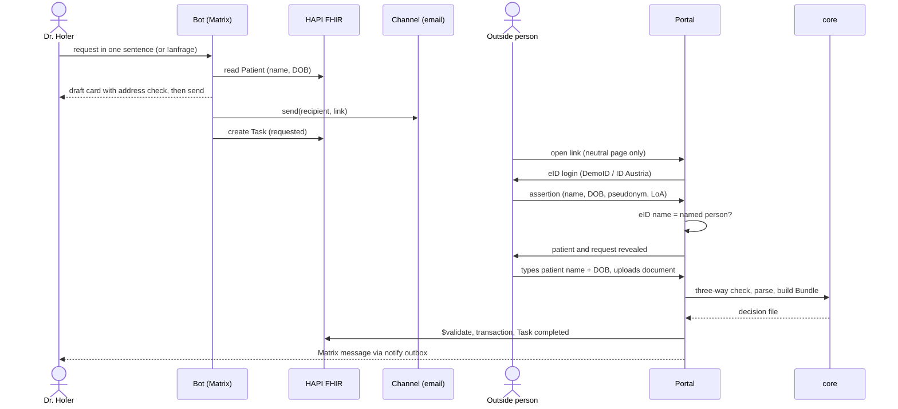

**Trust boundaries**

- Patient name and birth date stay in the clinic-side service until the outside person has passed the identity check. Before that, the link page shows only a neutral sentence with the clinic name.
- Delivery channels see only the recipient and the opaque link (`Channel.send(to, link)`). The message templates can use only the link and the clinic name.
- Nothing is written to HAPI unless the core decides `file` and HAPI `$validate` reports no errors, or Dr. Hofer confirms a `review` with `!ablegen` (file). A `reject` (document is about another patient) is quarantined, not filed.
- Unknown, expired, used and exhausted links all get the same neutral answer, so a guesser learns nothing.
- Only Matrix IDs in `AUTHORIZED_SENDERS` (the clinic directory; default Dr. Hofer) can make the bot request documents or file answers. Anyone else in the room gets "Keine Berechtigung" (no permission) and nothing happens.
- The public portal is the part that faces the internet. In the prototype we host it ourselves. In production it can move to a third-party trust provider such as FTAPI SubmitBox, behind the `Channel` and portal boundary, because it needs no patient data before the identity check. The prototype does not use FTAPI (see below).

## AI engine

One service, two jobs, one rule: **models read, rules decide, and every value must be a slice of the input.**

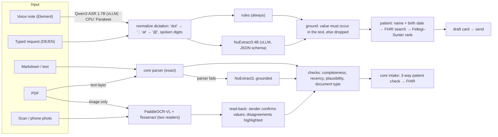

| Job | Input | Models (GPU) | CPU fallback | What is guaranteed |
|---|---|---|---|---|
| Request | typed or spoken German/English | Qwen3-ASR 1.7B, NuExtract3 4B | rules (regex, cue words), Parakeet TDT 0.6B v3 ONNX | every field is a slice of the transcript; contact disagreements between rules and model are asked back; a patient is picked only with two identifiers and a ≥6-bit margin |
| Document | Markdown, text | — (core parser) | — | identical to the scenario path |
| Document | PDF with text layer | — | pdfplumber | exact characters; same parser |
| Document | unusual text shape | NuExtract3 4B | — | only values that occur verbatim survive; numbers must match exactly |
| Document | scan, photo, image PDF | PaddleOCR-VL 1.6 | Tesseract (always runs, second reader) | never filed directly: the sender confirms a read-back screen; Provenance records it |

Checks on every answer (deterministic, never change a value): requested tests delivered (e.g. "4/4 requested parameters"), sample age vs. request date, unit and physical plausibility per LOINC, document type vs. request. They appear in Dr. Hofer's message.

Run it: `make engine` (local, rules + CPU), `make gpu-up` on the A5000 VM, then `ENGINE=http://<vm>:8100 make gpu-smoke`; point the app at it with `ENGINE_URL`. Model choices and the research behind them: DECISIONS.md.

## Design answers
### 1. How does an outside person prove who they are without a directory?
There is no directory of outside people, so Dr. Hofer's request takes its place: she names who must answer and one contact. The outside person then proves two things, and sees nothing about the patient until both hold. No account, no password, no app: a browser and the eID they already have.

1. **Possession of the contact.** The email or SMS carries a single-use link: a 256-bit random token (`app/tokens.py`). Only its SHA-256 hash is stored, together with the one request and the contact it was sent to. It expires after 72 h, stops working after 5 failed identity checks and is spent when the answer is submitted. Before login the page shows one neutral sentence with the clinic name; unknown, expired, used and exhausted links all get the same neutral page.
2. **Identity.** The person logs in with ID Austria, which returns name, birth date, a sector-specific pseudonym (bPK) and the level of assurance. The prototype simulates this with an HMAC-signed assertion carrying the same fields (`app/identity/eid_mock.py`), shown to testers as *DemoID* and clearly marked as a simulation; production uses the ID Austria OIDC login. People outside Austria use their own national EU eID through eIDAS (see answer 2).
3. **Binding.** The verified name must match the name Dr. Hofer typed (`policy.names_match`): titles, case and umlaut spelling are ignored, hyphen and space count the same, the eID may carry extra given names ("Eva Maria Brandl" matches "Dr. Eva Brandl"), and the family name must match in full. If it doesn't match, nothing is shown, the attempt is counted, `identity_checked FAILED` and `misdelivery_caught` go to the audit log, and Dr. Hofer gets a warning in Matrix.
4. **Need-to-know reveal.** Only after both proofs does the portal show the patient's name, birth date and what is requested, logged as `patient_revealed`.
5. **Record.** The audit log names `eid:<pseudonym> <name>` as the actor of `identity_checked`, `patient_revealed` and `answer_sent`. In FHIR, `Provenance.agent.who` is the verified sender, and its role text states both proofs (in German: "ID Austria (simuliert, LoA high), Namensabgleich OK; Besitz der Kontaktadresse über Einmal-Link", i.e. ID Austria (simulated, high assurance), name match OK, possession of the contact via the one-time link). The pseudonym stays in the audit log; it is not written to FHIR.

What this does not prove: that the person holds a role or licence. The eID proves *who* they are; that this person is the right one to send a lab result rests on Dr. Hofer's choice, as it does today when she picks up the phone. A lookup in a professional register is not built.
### 2. Which identity check per document type, and why?
Every answer needs two proofs: **possession** of the single-use link sent to the contact Dr. Hofer typed, and **identity** through ID Austria, with the verified name matching the person she named. What differs per document type is what we record and why the check matters. The rules live in `app/identity/policy.py`.

| Document | Required check | Filed automatically when | Why |
|---|---|---|---|
| Lab result | Link + ID Austria + name match with the requested person | The patient check says `file` (exact birth date, matching family name, W ≥ 4 bits) | Lab values drive a clinical decision, here coagulation before a procedure. A wrong value from the wrong sender is the costliest error, so the sender must be the named person. |
| Rehab discharge report | Link + ID Austria + name match; the report's author is recorded separately, as stated in the document | Same patient check | Discharge managers or admin staff often send reports on behalf of the physician who wrote them. We verify who sent it and keep the author from the document, so Provenance shows both. |

In every case a borderline patient match goes to Dr. Hofer (`review`, she confirms in Matrix), and a mismatch is quarantined (`reject`). Nothing reaches the FHIR server without the core's `file` decision or her confirmation.

**Without ID Austria.** People abroad log in with their own national eID: ID Austria accepts the eIDs that other EU states have notified under eIDAS (for example the German eID card), so a rehab clinic in Bavaria answers the same way. The prototype simulates this in `eid_mock.py`; production uses the same OIDC handoff.

**Deliberately not offered: link possession alone.** It can't tell the named person from a colleague she forwarded the email to (misdelivery M2), so the patient's data would be shown to whoever holds the link. People with no eID at all (most people outside the EU) can't answer through this service; for them the clinic stays on its current channel.
### 3. Which FHIR resources, and how do they reference each other and the patient?
The Patient already exists on the clinic's FHIR server; we read it, never create it. Sending a request creates a **Task**. An accepted answer is filed as one **transaction Bundle** (`core/fhir_build.py`): every new resource has a `urn:uuid` fullUrl, the server resolves the references, and either all resources are stored or none. Before that, HAPI `$validate` must report no errors (`intake_service._file`), and the Task is then set to `completed` with every filed resource in `Task.output`. Edge labels below are the FHIR elements as filed.

Request 1, lab result (10 resources in the Bundle, plus the Task):


Request 2, rehab discharge report (6 resources, plus the Task). The report's author comes from the document and is not identity-checked; the sender is.

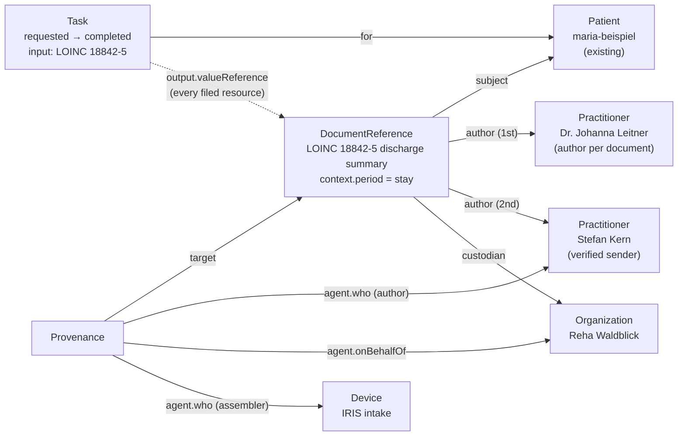

| Resource | Purpose | Key elements and codes |
|---|---|---|
| Patient | Who it is about (existing record) | Read for name and birth date, the "requested" side of the three-way patient check |
| Task | The open request and its outcome | `status` requested → completed (filed) or → in-progress (wrong patient, still waiting); `intent` order; `for` Patient; `input` = requested document type (LOINC 11502-2 / 18842-5); `executionPeriod` start at sending, end at closing; `restriction.period.end` = link expiry; `requester` / `owner` as display names; `output` = filed resources |
| Observation | One per lab value, so values are queryable, not just a PDF | `category` laboratory; `code` LOINC (INR 6301-6, aPTT 14979-9, platelets 777-3, fibrinogen 3255-7) plus the lab's own label; `valueQuantity` with UCUM (`s`, `10*9/L`, `g/L`; INR has no unit); `referenceRange` low/high + the lab's text; `interpretation` (v3 ObservationInterpretation, here all `N`); `effectiveDateTime` = sample taken, `issued` = reported |
| DiagnosticReport | The lab report as a whole | `category` v2-0074 LAB; `code` LOINC 11502-2; `result` → Observations; `presentedForm` = original; `conclusion` = the lab's comment |
| DocumentReference | The original, unchanged | Lab: type LOINC 11502-2. Rehab: LOINC 18842-5, `context.period` = stay. Original file as attachment with size and SHA-1 hash; `author`, `custodian` |
| Provenance | Who sent it, how that was checked, what software filed it | `target` = the clinical resources (Observations, DiagnosticReport, DocumentReference); `occurredDateTime` / `recorded`; `policy` → answer 2; agent `author` = verified sender, `role.text` = both identity proofs, `onBehalfOf` = their organisation; agent `assembler` = Device; lab only: `entity` (source) = the original DocumentReference |
| Practitioner, Organization, Device | Targets of the references above | Name only, no identifier |

The filed resources do not point back at the Task (no `basedOn`); `Task.output` is the link from request to answer. FHIR timestamps are Europe/Vienna, so offsets are correct across daylight saving time.

**Validation.** The official HL7 validator (`make validate`, `-version 4.0`) reports **0 errors** on both scenario bundles built by `core/` (10 and 6 warnings, all dom-6 "resource should have narrative", a best-practice hint).
### 4. How do we notice a misdelivery?
Three independent checks, one per way a document goes astray (`scenario/misdelivery.md`):

| Test | Caught by | When | Result (METRICS.md) |
|---|---|---|---|
| **M1** wrong address (`labor-kanaI`) | Address lint on the draft card (look-alike characters, typos, capitals or non-ASCII in the domain), then the identity binding if it is sent anyway | Before sending; again at login | Caught in 4/4 runs, nothing shown |
| **M2** forwarded to a colleague | Identity binding: the eID name must be the person Dr. Hofer named | At login, before anything is shown | Caught in 4/4 runs, nothing shown |
| **M3** document about another patient | Three-way Fellegi–Sunter record linkage: requested patient ↔ name and birth date typed by the sender ↔ patient in the document | After upload, before filing | Caught in 6/6 runs, nothing filed |

The patient check scores each pair of records in bits (log₂ of how much more likely the agreement pattern is for the same person than for different people). Auto-filing needs W ≥ 4 bits **and** an exact birth date **and** a matching family name; W ≤ −6 is rejected; anything in between goes to Dr. Hofer. On 3,000 held-out synthetic pairs: **0 wrongly filed**, 0.07 % wrongly rejected, 8 % sent to review, AUC 0.9999 ([core/METRICS_matching.md](core/METRICS_matching.md)). On 17 jury-style documents (other labs, German labels, missing or wrong LOINC codes, wrong patient, namesake, name typo): **0/17 wrongly filed**, 14 exactly as expected, 3 more sent to review, the safe side. Every catch is logged as `misdelivery_caught` with M1/M2/M3, and Dr. Hofer is warned without the other patient ever being named.
### 5. Where does the service run?
Mostly at the clinic. Only the link page and the answer form face the internet, and the outside organisation runs nothing.

| Part | Runs at | Sees patient data |
|---|---|---|
| Matrix (Synapse), bot, request and intake logic, `core/` (patient check, FHIR building), HAPI, audit log, SQLite | Clinic, inside its network | Yes. The clinic is the controller, and the data stays there. |
| Portal: link page, eID login, answer form | Internet-facing. Prototype: hosted by us. Production: the clinic's DMZ, or a third-party trust provider such as FTAPI SubmitBox | Nothing before the identity check. After it: the requested patient's name and birth date, the request, and the uploaded answer in transit. |
| Email / SMS delivery | Any SMTP relay or SMS gateway | No: recipient and link only |
| ID Austria / eIDAS eID | The eID provider | No: it only sees that the person logs in to the service |
| Outside organisation | Nothing to install: a browser and their eID | Only the request addressed to them, after identity |

In the prototype, one FastAPI process serves the portal and the clinic side (`app/main.py`). The split above is the boundary we built for (`Channel.send(to, link)` and `EidAssertion`, see [Every component is replaceable](#every-component-is-replaceable)); it is not yet two separate deployments.

Data protection, as designed (a design, not a legal assessment; a DPIA would come before production):
- **Minimisation.** Emails and SMS carry only the link and the clinic name; `tests/test_template_leak.py` fails if a template contains a patient name, birth date or document-type word. The audit log stores contacts masked (`e***@labor-kanal.example`), and for a wrong-patient answer (M3) only match scores, never the other patient's name or birth date.
- **Roles.** The clinic is the controller. Whoever hosts the portal or delivers the messages (us, FTAPI, an SMS gateway) is a processor and needs a processor agreement (Art. 28 GDPR).
- **Retention.** Production needs retention periods per kind of record, starting with deleting quarantined answers once Dr. Hofer has dealt with them; the prototype keeps everything.
- **Accountability.** The audit log is append-only with a SHA-256 hash chain: editing a row, or deleting one before the newest, breaks `verify_chain()`. Tampering becomes visible; keeping the latest hash outside the database as well would also expose a cut-off tail. In production the `/audit` page sits behind the clinic login.

## Every component is replaceable
Each simulated part sits behind one small interface. Swapping it touches the file named in the right column, not the rest.

| Simulated / chosen here | Production replacement | Interface that stays the same |
|---|---|---|
| Mailpit (catches emails) | Any SMTP relay | `Channel.send(to, link)` in `app/delivery/base.py`; `smtp_mailpit.py` only needs `SMTP_HOST` / `SMTP_PORT` changed |
| SMS inbox page (`/sms`) | An SMS gateway | `Channel.send(to, link)`; a new `Channel` with `kind = "sms"` replaces `sms_inbox.py` |
| Mock eID, *DemoID* (`identity/eid_mock.py`) | ID Austria via OIDC | `EidAssertion` returned by `eid_mock.verify()`: name, birth date, pseudonym (bPK), level of assurance. The portal consumes only this object. |
| HAPI FHIR server | Any FHIR R4 server | `app/fhir_client.py` uses plain FHIR REST (read Patient, create Task, `$validate`, transaction) |
| Our own upload portal + Mailpit | A secure-transfer provider such as FTAPI SubmitBox | `Channel.send(to, link)`; `EMAIL_CHANNEL` selects the channel. **Not used in the prototype.** FTAPI states that a REST API exists but publishes no reference (access is licence-gated), and we did not invent endpoints. `app/delivery/ftapi_submitbox.py` marks where the adapter goes. |
| Synapse + Element | Any Matrix homeserver and client, or PGK | `bot.py` speaks the Matrix client-server API (matrix-nio) and calls `commands.handle(text, sender)` |
| SQLite | Postgres | Only `app/db.py` imports `sqlite3` |

## Metrics
See [METRICS.md](METRICS.md) (generated by `make metrics`) and [core/METRICS_matching.md](core/METRICS_matching.md).

| Track metric | Result | Target |
|---|---|---|
| FHIR validation (HL7 validator) | 0 errors on both scenario bundles | 0 |
| Outside person: installs / accounts | 0 / 0 (a link and an eID in the browser) | 0 / 0, under 2 min |
| Misdeliveries caught | 3/3 | 3/3 |
| Audit coverage | 6/6 steps with who, what, when; hash chain intact | 6/6 |
| Patient data in email/SMS | 0 in 24 emails and 5 SMS | 0 |

## What works / what doesn't

**Works**
- The whole flow on the scenario: request in one sentence → neutral link → eID → upload (PDF, Markdown, text, photo with read-back) → valid FHIR on HAPI → message in Matrix.
- All three misdelivery tests (M1 warned before sending and blocked at login, M2 blocked, M3 quarantined without naming the other patient), each logged.
- Audit log with all 6 required events and a SHA-256 hash chain; `/audit` page in English and German.
- HL7 validator: 0 errors on both scenario bundles.

**Simulated or not built**
- ID Austria is simulated (*DemoID*); production uses the OIDC login. People without any eID can't answer this way; for them the existing route stays.
- FTAPI SubmitBox is not wired (no public API reference); the adapter boundary is there.
- Each answer creates a new Practitioner and Organization without an identifier (no de-duplication). No retention or deletion of stored answers yet.

## Team
See [TEAM.md](TEAM.md).
