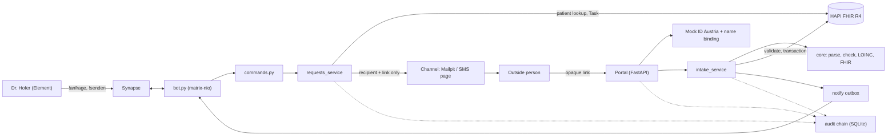
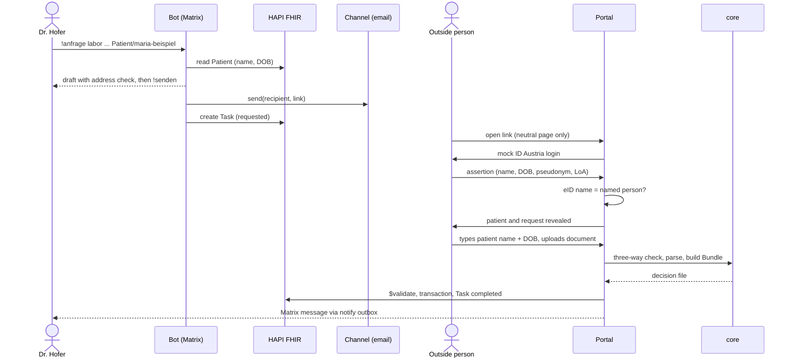
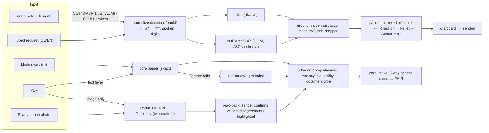

# BefundBrücke

A doctor in a closed Matrix network asks someone outside it for a document. BefundBrücke gets it in
through a one-time link, proves it comes from the right person and is about the right patient, and files
it as valid FHIR R4: automatically, audited, with Dr. Hofer told in Matrix.

AIM Healthcare Hackathon Vienna 2026, Track 2 (Health Data Interoperability, partner FTAPI). Synthetic data only.

## Run it

Needs Docker, [uv](https://docs.astral.sh/uv/), Java 17+ (only for the HL7 validator).

```
make install      # python deps
make test         # unit + end-to-end flow tests, no Docker
make up           # Synapse + Element + HAPI + Mailpit + app, users/room/patient set up
```

| What | Where |
|---|---|
| Element (Dr. Hofer) | http://localhost:8080 — user `lena.hofer`, password in `.env` |
| Mailpit (emails) | http://localhost:8025 |
| SMS (simulated) | http://localhost:8000/sms |
| Audit log | http://localhost:8000/audit |
| HAPI FHIR | http://localhost:8090/fhir |

In the room: `!anfrage labor "Dr. Eva Brandl" eva.brandl@labor-kanal.example Patient/maria-beispiel Grund: Gerinnung vor Eingriff`, then `!senden <id>`.

## Architecture
BefundBrücke has a deterministic core, a FastAPI service around it, and five off-the-shelf services.

**Models and services.** Every decision is deterministic or statistical: patient matching is a calibrated record-linkage model (Fellegi–Sunter, weights estimated on synthetic labelled pairs, `core/weights.json`); parsing of the scenario format, LOINC checks, FHIR building and the identity policy are rules. Models only *read* (see [AI engine](#ai-engine)): Dr. Hofer's typed or spoken request, and answers that arrive as PDF, scan or phone photo. They run self-hosted on one GPU (vLLM), every value they return must be a slice of the input, and the rules above still decide. Services we run but did not write: Synapse, Element Web, HAPI FHIR R4, Mailpit, SQLite.

| Component | Built / used | Role |
|---|---|---|
| `core/` (stdlib only) | built | `parse_doc.py`: Markdown parser (EN + DE). `fs_matcher.py`: Fellegi–Sunter check of the patient, three ways: requested ↔ typed ↔ document. `loinc.py`: check digit and code/name consistency, never invents a code. `fhir_build.py`: transaction Bundle (lab: Observation per row with LOINC, UCUM, reference range, interpretation; DiagnosticReport; DocumentReference with the original; Provenance. Rehab report: DocumentReference LOINC 18842-5 + Provenance). Provenance agents: the verified sender and our Device. `intake.py` returns the decision file / review / reject. |
| `app/` (FastAPI) | built | Public portal and clinic-side logic: `commands.py` (doctor commands, shared by bot and CLI), `bot.py` (matrix-nio), `requests_service.py` (draft → send: single-use link, channel, FHIR Task), `misdelivery.py`, `intake_service.py` (core decision → HAPI `$validate` → transaction → Task completed; review → `!ablegen` / `!verwerfen`; reject → quarantine), `fhir_client.py`, `db.py`. |
| `app/tokens.py` | built | 256-bit random link token, only its SHA-256 is stored, TTL 72 h, max 5 identity attempts, single use. |
| `app/delivery/` | built | `Channel` interface: `send(to, link)` receives only recipient and link, so no patient data can reach a channel. Implementations: `smtp_mailpit`, `sms_inbox` (simulated SMS page), `ftapi_submitbox` (stub). |
| `app/identity/` | built | `eid_mock.py`: simulated ID Austria assertion (name, birth date, bPK-like pseudonym, level of assurance), HMAC-signed. `policy.py`: name binding, the eID name must equal the person Dr. Hofer named. |
| `app/audit.py` | built | Append-only log, SHA-256 hash chain; the 6 required events (request_sent, link_opened, identity_checked, answer_sent, answer_filed, misdelivery_caught) plus extra events. |
| `app/notify.py` | built | Outbox table that the bot drains into the Matrix room. |
| `engine/` (FastAPI, :8100) | built | AI engine, see [AI engine](#ai-engine): request job (typed/spoken DE+EN → checked request) and document job (Markdown/PDF/scan/photo → scenario-shaped Markdown + completeness/recency/plausibility checks). Stateless; the app calls it over HTTP (`ENGINE_URL`). |
| vLLM: NuExtract3 4B, Qwen3-ASR 1.7B, PaddleOCR-VL 1.6 | used | Open-weight models on one A5000 (`deploy/gpu/`). Each is optional: without it the engine falls back to rules / CPU (Tesseract, Parakeet ONNX). |
| Synapse + Element Web | used | Matrix homeserver (`klinikum.example`) and Dr. Hofer's client. |
| HAPI FHIR R4 | used | Patient source, Task lifecycle, `$validate`, store for filed resources. |
| Mailpit | used | Catches the outgoing emails. |
| SQLite | used | Requests, tokens, answers, audit, outboxes (only `app/db.py` imports it). |



Request 1 (lab values), happy path. Every step is written to the audit log.



**Trust boundaries**

- Patient name and birth date stay in the clinic-side service until the outside person has passed the identity check. Before that, the link page shows only a neutral sentence with the clinic name.
- Delivery channels see only the recipient and the opaque link (`Channel.send(to, link)`). The message templates can use only the link and the clinic name.
- Nothing is written to HAPI unless the core decides `file` and HAPI `$validate` reports no errors, or Dr. Hofer confirms a `review` with `!ablegen`. A `reject` (document is about another patient) is quarantined, not filed.
- Unknown, expired, used and exhausted links all get the same neutral answer, so a guesser learns nothing.
- Only Matrix IDs in `AUTHORIZED_SENDERS` (the clinic directory; default Dr. Hofer) can make the bot request documents or file answers. Anyone else in the room gets "Keine Berechtigung" and nothing happens.
- The public portal is the part that faces the internet. In the prototype we host it ourselves. In production it can move to a third-party trust provider such as FTAPI SubmitBox, behind the `Channel` and portal boundary, because it needs no patient data before the identity check. The prototype does not use FTAPI (see below).

## AI engine

One service, two jobs, one rule: **models read, rules decide, and every value must be a slice of the input.**



| Job | Input | Models (GPU) | CPU fallback | What is guaranteed |
|---|---|---|---|---|
| Request | typed or spoken German/English | Qwen3-ASR 1.7B, NuExtract3 4B | rules (regex, cue words), Parakeet TDT 0.6B v3 ONNX | every field is a slice of the transcript; contact disagreements between rules and model are asked back; a patient is picked only with two identifiers and a ≥6-bit margin |
| Document | Markdown, text | — (core parser) | — | identical to the scenario path |
| Document | PDF with text layer | — | pdfplumber | exact characters; same parser |
| Document | unusual text shape | NuExtract3 4B | — | only values that occur verbatim survive; numbers must match exactly |
| Document | scan, photo, image PDF | PaddleOCR-VL 1.6 | Tesseract (always runs, second reader) | never filed directly: the sender confirms a read-back screen; Provenance records it |

Checks on every answer (deterministic, never change a value): requested tests delivered (e.g. "4/4 angefragte Parameter"), sample age vs. request date, unit and physical plausibility per LOINC, document type vs. request. They appear in Dr. Hofer's message.

Run it: `make engine` (local, rules + CPU), `make gpu-up` on the A5000 VM, then `ENGINE=http://<vm>:8100 make gpu-smoke`; point the app at it with `ENGINE_URL`. Model choices and the research behind them: DECISIONS.md.

## Design answers
### 1. How does an outside person prove who they are without a directory?
<!-- TODO(MedEng) -->
### 2. Which identity check per document type, and why?
<!-- TODO(MedEng): table from app/identity/policy.py -->
### 3. Which FHIR resources, and how do they reference each other and the patient?
<!-- TODO(MedEng): Mermaid diagram -->
### 4. How do we notice a misdelivery?
<!-- TODO(Biostat): lint + identity binding + three-way Fellegi–Sunter, numbers from METRICS.md -->
### 5. Where does the service run?
<!-- TODO(MedEng) -->

## Every component is replaceable
Each simulated part sits behind one small interface. Swapping it touches the file named in the right column, not the rest.

| Simulated / chosen here | Production replacement | Interface that stays the same |
|---|---|---|
| Mailpit (catches emails) | Any SMTP relay | `Channel.send(to, link)` in `app/delivery/base.py`; `smtp_mailpit.py` only needs `SMTP_HOST` / `SMTP_PORT` changed |
| SMS inbox page (`/sms`) | An SMS gateway | `Channel.send(to, link)`; a new `Channel` with `kind = "sms"` replaces `sms_inbox.py` |
| Mock eID (`identity/eid_mock.py`) | ID Austria via OIDC | `EidAssertion` returned by `eid_mock.verify()`: name, birth date, pseudonym (bPK), level of assurance. The portal consumes only this object. |
| HAPI FHIR server | Any FHIR R4 server | `app/fhir_client.py` uses plain FHIR REST (read Patient, create Task, `$validate`, transaction) |
| Our own upload portal + Mailpit | A secure-transfer provider such as FTAPI SubmitBox | `Channel.send(to, link)`; `EMAIL_CHANNEL` selects the channel. **Not used in the prototype.** FTAPI states that a REST API exists but publishes no reference (access is licence-gated), and we did not invent endpoints. `app/delivery/ftapi_submitbox.py` marks where the adapter goes. |
| Synapse + Element | Any Matrix homeserver and client, or PGK | `bot.py` speaks the Matrix client-server API (matrix-nio) and calls `commands.handle(text, sender)` |
| SQLite | Postgres | Only `app/db.py` imports `sqlite3` |

## Metrics
See [METRICS.md](METRICS.md) (generated by `make metrics`) and [core/METRICS_matching.md](core/METRICS_matching.md).

## What works / what doesn't
<!-- TODO(all, Friday): honest list, same as in the video -->

## Team
See [TEAM.md](TEAM.md).
