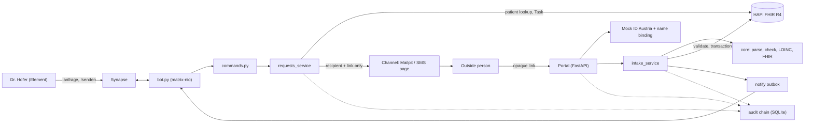
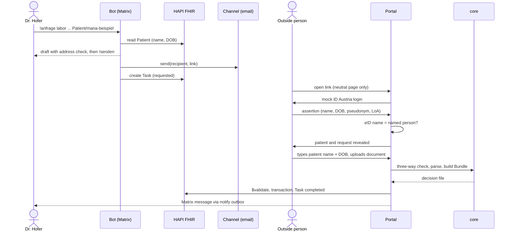
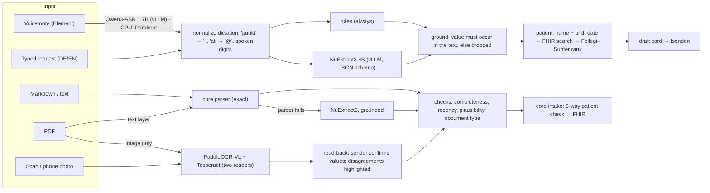
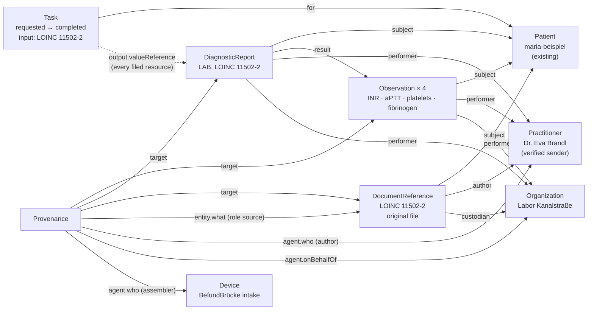
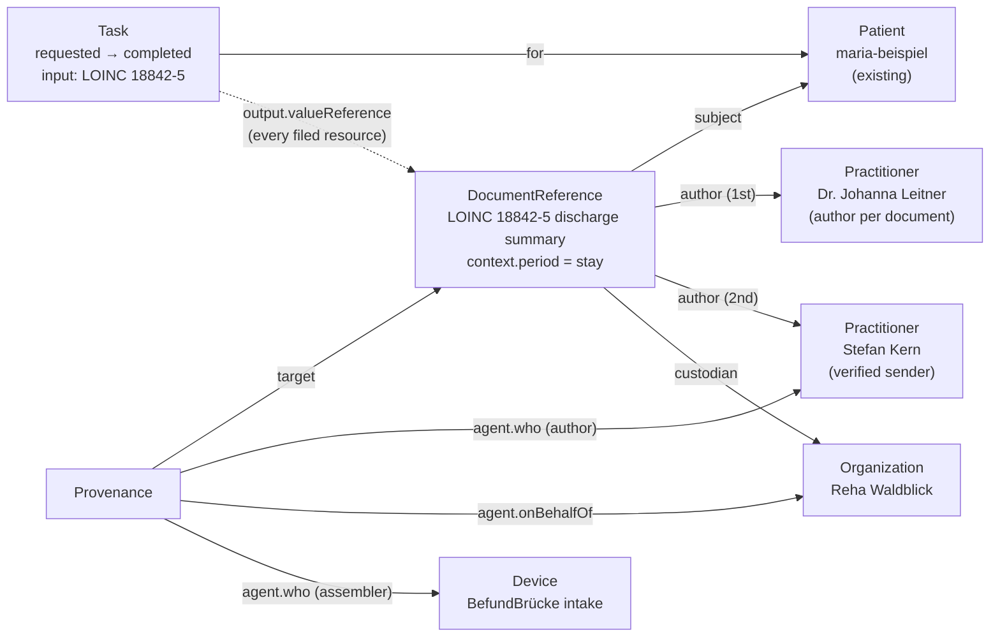

# BefundBrücke

A doctor in a closed Matrix network asks someone outside it for a document. BefundBrücke gets it in
through a one-time link, proves it comes from the right person and is about the right patient, and files
it as valid FHIR R4: automatically, audited, with Dr. Hofer told in Matrix.

AIM Healthcare Hackathon Vienna 2026, Track 2 (Health Data Interoperability, partner FTAPI). Synthetic data only.

## Run it

Needs Docker, [uv](https://docs.astral.sh/uv/), Java 17+ (only for the HL7 validator).

```
make install      # python deps
make test         # unit + end-to-end flow tests, no Docker
make up           # Synapse + Element + HAPI + Mailpit + app, users/room/patient set up
```

| What | Where |
|---|---|
| Element (Dr. Hofer) | http://localhost:8080 — user `lena.hofer`, password in `.env` |
| Mailpit (emails) | http://localhost:8025 |
| SMS (simulated) | http://localhost:8000/sms |
| Audit log | http://localhost:8000/audit |
| HAPI FHIR | http://localhost:8090/fhir |

In the room: `!anfrage labor "Dr. Eva Brandl" eva.brandl@labor-kanal.example Patient/maria-beispiel Grund: Gerinnung vor Eingriff`, then `!senden <id>`.

The portal accepts Markdown or plain-text files (`.md`, `.txt`) or pasted text. PDF upload is not supported in the prototype.

Browser end-to-end test of the portal (request 1 timed, request 2 via `/sms`, M1–M3), JSON on stdout and in `var/e2e.json`:

```
uv run python scripts/e2e.py            # against the running stack (make up)
uv run python scripts/e2e.py --local    # no Docker: app in-process, fake HAPI
```

It needs a Chromium: `uv run playwright install chromium`, or a system `chromium` on the PATH.

## Architecture
BefundBrücke has a deterministic core, a FastAPI service around it, and five off-the-shelf services.

**Models and services.** Every decision is deterministic or statistical: patient matching is a calibrated record-linkage model (Fellegi–Sunter, weights estimated on synthetic labelled pairs, `core/weights.json`); parsing of the scenario format, LOINC checks, FHIR building and the identity policy are rules. Models only *read* (see [AI engine](#ai-engine)): Dr. Hofer's typed or spoken request, and answers that arrive as PDF, scan or phone photo. They run self-hosted on one GPU (vLLM), every value they return must be a slice of the input, and the rules above still decide. Services we run but did not write: Synapse, Element Web, HAPI FHIR R4, Mailpit, SQLite.

| Component | Built / used | Role |
|---|---|---|
| `core/` (stdlib only) | built | `parse_doc.py`: Markdown parser (EN + DE). `fs_matcher.py`: Fellegi–Sunter check of the patient, three ways: requested ↔ typed ↔ document. `loinc.py`: check digit and code/name consistency, never invents a code. `fhir_build.py`: transaction Bundle (lab: Observation per row with LOINC, UCUM, reference range, interpretation; DiagnosticReport; DocumentReference with the original; Provenance. Rehab report: DocumentReference LOINC 18842-5 + Provenance). Provenance agents: the verified sender and our Device. `intake.py` returns the decision file / review / reject. |
| `app/` (FastAPI) | built | Public portal and clinic-side logic: `commands.py` (doctor commands, shared by bot and CLI), `bot.py` (matrix-nio), `requests_service.py` (draft → send: single-use link, channel, FHIR Task), `misdelivery.py`, `intake_service.py` (core decision → HAPI `$validate` → transaction → Task completed; review → `!ablegen` / `!verwerfen`; reject → quarantine), `fhir_client.py`, `db.py`. |
| `app/portal_router.py` | built | Public-facing portal routes (wave 2 split from `main.py`): link open, mock eID login, answer form, readback confirmation, simulated SMS inbox. Mounted by `main.py`; omitted when `PORTAL_ONLY=1` is not set on the clinic container. |
| `app/clinic_router.py` | built | Clinic-internal routes: `/audit`, `/audit/apple`, `/audit.json`, `/dashboard`, `POST /admin/purge`. Omitted entirely when `PORTAL_ONLY=1` so these endpoints are unreachable from the internet-facing container. |
| `app/db.py` — `purge()` | built | TTL-based purge: removes quarantined answers older than `QUARANTINE_TTL_DAYS` (default 30) and used/expired tokens older than `TOKEN_TTL_DAYS` (default 90). Called by `POST /admin/purge`; not yet wired to a cron job (production TODO). |
| `PORTAL_ONLY` env var | built | When `"1"`, `main.py` mounts only `portal_router` and skips `clinic_router`. Enables a two-container production deployment: one internet-facing pod (`PORTAL_ONLY=1`), one internal pod (full access). |
| `app/tokens.py` | built | 256-bit random link token, only its SHA-256 is stored, TTL 72 h, max 5 identity attempts, single use. |
| `app/delivery/` | built | `Channel` interface: `send(to, link)` receives only recipient and link, so no patient data can reach a channel. Implementations: `smtp_mailpit`, `sms_inbox` (simulated SMS page), `ftapi_submitbox` (stub). |
| `app/identity/` | built | `eid_mock.py`: simulated ID Austria assertion (name, birth date, bPK-like pseudonym, level of assurance), HMAC-signed and bound to the link token. `policy.py`: name binding, the eID name must equal the person Dr. Hofer named. |
| `app/audit.py` | built | Append-only log, SHA-256 hash chain; the 6 required events (request_sent, link_opened, identity_checked, answer_sent, answer_filed, misdelivery_caught) plus extra events. |
| `app/notify.py` | built | Outbox table that the bot drains into the Matrix room. |
| `engine/` (FastAPI, :8100) | built | AI engine, see [AI engine](#ai-engine): request job (typed/spoken DE+EN → checked request) and document job (Markdown/PDF/scan/photo → scenario-shaped Markdown + completeness/recency/plausibility checks). Stateless; the app calls it over HTTP (`ENGINE_URL`). |
| vLLM: NuExtract3 4B, Qwen3-ASR 1.7B, PaddleOCR-VL 1.6 | used | Open-weight models on one A5000 (`deploy/gpu/`). Each is optional: without it the engine falls back to rules / CPU (Tesseract, Parakeet ONNX). |
| Synapse + Element Web | used | Matrix homeserver (`klinikum.example`) and Dr. Hofer's client. |
| HAPI FHIR R4 | used | Patient source, Task lifecycle, `$validate`, store for filed resources. |
| Mailpit | used | Catches the outgoing emails. |
| SQLite | used | Requests, tokens, answers, audit, outboxes (only `app/db.py` imports it). |



Request 1 (lab values), happy path. Every step is written to the audit log.



**Trust boundaries**

- Patient name and birth date stay in the clinic-side service until the outside person has passed the identity check. Before that, the link page shows only a neutral sentence with the clinic name.
- Delivery channels see only the recipient and the opaque link (`Channel.send(to, link)`). The message templates can use only the link and the clinic name.
- Nothing is written to HAPI unless the core decides `file` and HAPI `$validate` reports no errors, or Dr. Hofer confirms a `review` with `!ablegen`. A `reject` (document is about another patient) is quarantined, not filed.
- Unknown, expired, used and exhausted links all get the same neutral answer, so a guesser learns nothing.
- Only Matrix IDs in `AUTHORIZED_SENDERS` (the clinic directory; default Dr. Hofer) can make the bot request documents or file answers. Anyone else in the room gets "Keine Berechtigung" and nothing happens.
- The public portal is the part that faces the internet. In the prototype we host it ourselves. In production it can move to a third-party trust provider such as FTAPI SubmitBox, behind the `Channel` and portal boundary, because it needs no patient data before the identity check. The prototype does not use FTAPI (see below).

> **Production: eID Austria.** The mock eID (`eid_mock.py`) is for the prototype only and is not bound to the link. In production: use the ID Austria OIDC authorization-code flow; encode the link token in the `state` parameter; use a single-use `nonce` bound to the session to prevent replay. The `EidAssertion` interface stays the same — only `eid_mock.verify()` is replaced by the OIDC library callback.

## AI engine

One service, two jobs, one rule: **models read, rules decide, and every value must be a slice of the input.**



| Job | Input | Models (GPU) | CPU fallback | What is guaranteed |
|---|---|---|---|---|
| Request | typed or spoken German/English | Qwen3-ASR 1.7B, NuExtract3 4B | rules (regex, cue words), Parakeet TDT 0.6B v3 ONNX | every field is a slice of the transcript; contact disagreements between rules and model are asked back; a patient is picked only with two identifiers and a ≥6-bit margin |
| Document | Markdown, text | — (core parser) | — | identical to the scenario path |
| Document | PDF with text layer | — | pdfplumber | exact characters; same parser |
| Document | unusual text shape | NuExtract3 4B | — | only values that occur verbatim survive; numbers must match exactly |
| Document | scan, photo, image PDF | PaddleOCR-VL 1.6 | Tesseract (always runs, second reader) | never filed directly: the sender confirms a read-back screen; Provenance records it |

Checks on every answer (deterministic, never change a value): requested tests delivered (e.g. "4/4 angefragte Parameter"), sample age vs. request date, unit and physical plausibility per LOINC, document type vs. request. They appear in Dr. Hofer's message.

Run it: `make engine` (local, rules + CPU), `make gpu-up` on the A5000 VM, then `ENGINE=http://<vm>:8100 make gpu-smoke`; point the app at it with `ENGINE_URL`. Model choices and the research behind them: DECISIONS.md.

## Design answers
### 1. How does an outside person prove who they are without a directory?
There is no directory of outside people, so Dr. Hofer's request takes its place: she names who must answer and one contact (`!anfrage labor "Dr. Eva Brandl" eva.brandl@labor-kanal.example …`). The outside person then proves two things, and sees nothing about the patient until both hold. No account, no password, no app: a browser and the eID they already have.

1. **Possession of the contact.** The email or SMS carries a single-use link: a 256-bit random token (`app/tokens.py`). Only its SHA-256 hash is stored, together with the one request and the contact it was sent to. It expires after 72 h, stops working after 5 failed identity checks and is spent when the answer is submitted. Before login the page shows one neutral sentence with the clinic name; unknown, expired, used and exhausted links all get the same neutral page.
2. **Identity.** The person logs in with ID Austria, which returns name, birth date, a sector-specific pseudonym (bPK) and the level of assurance. The prototype simulates this with an HMAC-signed assertion carrying the same fields (`app/identity/eid_mock.py`); production uses the ID Austria OIDC login. People outside Austria use their own national EU eID through eIDAS (see answer 2).
3. **Binding.** The verified name must equal the name Dr. Hofer typed; titles, case and umlaut spelling are ignored (`policy.names_match`). If it doesn't match, nothing is shown, the attempt is counted, `identity_checked FAILED` and `misdelivery_caught` go to the audit log, and Dr. Hofer gets a warning in Matrix.
4. **Need-to-know reveal.** Only after both proofs does the portal show the patient's name, birth date and what is requested, logged as `patient_revealed`.
5. **Record.** The audit log names `eid:<pseudonym> <name>` as the actor of `identity_checked`, `patient_revealed` and `answer_sent`. In FHIR, `Provenance.agent.who` is the verified sender, and its role text states both proofs ("ID Austria (simuliert, LoA high), Namensabgleich OK; Besitz der Kontaktadresse über Einmal-Link"). The pseudonym stays in the audit log; it is not written to FHIR.

What this does not prove: that the person holds a role or licence. The eID proves *who* they are; that this person is the right one to send a lab result rests on Dr. Hofer's choice, as it does today when she picks up the phone. A lookup in a professional register is not built.
### 2. Which identity check per document type, and why?
Every answer needs two proofs: **possession** of the single-use link sent to the contact Dr. Hofer typed, and **identity** through ID Austria, with the verified name matching the person she named. What differs per document type is what we record and why the check matters. The rules live in `app/identity/policy.py`.

| Document | Required check | Filed automatically when | Why |
|---|---|---|---|
| Lab result | Link + ID Austria + name match with the requested person | The patient check says `file` (exact birth date, matching family name, W ≥ 4 bits) | Lab values drive a clinical decision, here coagulation before a procedure. A wrong value from the wrong sender is the costliest error, so the sender must be the named person. |
| Rehab discharge report | Link + ID Austria + name match; the report's author is recorded separately, as stated in the document | Same patient check | Discharge managers or admin staff often send reports on behalf of the physician who wrote them. We verify who sent it and keep the author from the document, so Provenance shows both. |

In every case a borderline patient match goes to Dr. Hofer (`review`, she confirms in Matrix), and a mismatch is quarantined (`reject`). Nothing reaches the FHIR server without the core's `file` decision or her confirmation.

**Without ID Austria.** People abroad log in with their own national eID: ID Austria accepts the eIDs that other EU states have notified under eIDAS (for example the German eID card), so a rehab clinic in Bavaria answers the same way. The prototype simulates this in `eid_mock.py`; production uses the same OIDC handoff.

**Deliberately not offered: link possession alone.** It can't tell the named person from a colleague she forwarded the email to (misdelivery M2), so the patient's data would be shown to whoever holds the link. People with no eID at all (most people outside the EU) can't answer through this service; for them the clinic stays on its current channel. We name this limit rather than weaken the check.
### 3. Which FHIR resources, and how do they reference each other and the patient?
The Patient already exists on the clinic's FHIR server; we read it, never create it. Sending a request creates a **Task**. An accepted answer is filed as one **transaction Bundle** (`core/fhir_build.py`): every new resource has a `urn:uuid` fullUrl, the server resolves the references, and either all resources are stored or none. Before that, HAPI `$validate` must report no errors (`intake_service._file`), and the Task is then set to `completed` with every filed resource in `Task.output`. Edge labels below are the FHIR elements as filed.

Request 1, lab result (10 resources in the Bundle, plus the Task):



Request 2, rehab discharge report (6 resources, plus the Task). The report's author comes from the document and is not identity-checked; the sender is.



| Resource | Purpose | Key elements and codes |
|---|---|---|
| Patient | Who it is about (existing record) | Read for name and birth date, the "requested" side of the three-way patient check |
| Task | The open request and its outcome | `status` requested → completed (filed) or → in-progress (wrong patient, still waiting); `intent` order; `for` Patient; `input` = requested document type (LOINC 11502-2 / 18842-5); `executionPeriod` start at sending, end at closing; `restriction.period.end` = link expiry; `requester` / `owner` as display names; `output` = filed resources |
| Observation | One per lab value, so values are queryable, not just a PDF | `category` laboratory; `code` LOINC (INR 6301-6, aPTT 14979-9, platelets 777-3, fibrinogen 3255-7) plus the lab's own label; `valueQuantity` with UCUM (`s`, `10*9/L`, `g/L`; INR has no unit); `referenceRange` low/high + the lab's text; `interpretation` (v3 ObservationInterpretation, here all `N`); `effectiveDateTime` = sample taken, `issued` = reported |
| DiagnosticReport | The lab report as a whole | `category` v2-0074 LAB; `code` LOINC 11502-2; `result` → Observations; `presentedForm` = original; `conclusion` = the lab's comment |
| DocumentReference | The original, unchanged | Lab: type LOINC 11502-2. Rehab: LOINC 18842-5, `context.period` = stay. Original Markdown as attachment with size and SHA-1 hash; `author`, `custodian` |
| Provenance | Who sent it, how that was checked, what software filed it | `target` = the clinical resources (Observations, DiagnosticReport, DocumentReference); `occurredDateTime` / `recorded`; `policy` → answer 2; agent `author` = verified sender, `role.text` = both identity proofs, `onBehalfOf` = their organisation; agent `assembler` = Device; lab only: `entity` (source) = the original DocumentReference |
| Practitioner, Organization, Device | Targets of the references above | Practitioner and Organization include an `identifier` element with a system+value pair so that repeated sends from the same practitioner/organisation do not create duplicate resources; `ifNoneExist` on the FHIR conditional create prevents duplicates on HAPI. |

The filed resources do not point back at the Task (no `basedOn`); `Task.output` is the link from request to answer. FHIR timestamps are Europe/Vienna, so offsets are correct across daylight saving time.

**Validation.** The official HL7 validator (`make validate`, `-version 4.0`) reports **0 errors** on both scenario bundles built by `core/` (10 and 6 warnings, all dom-6 "resource should have narrative", a best-practice hint). That needs the `Provenance.policy` fix in an open PR (`medeng/validator-zero`): until it is merged, `policy` points at example.org and the validator reports 1 error per bundle. The rerun on bundles filed through the live stack is still to do.
### 4. How do we notice a misdelivery?
Three independent checks run in sequence, so a misdelivery must defeat all three to cause harm. The numbers in brackets are from the scenario runs in [METRICS.md](METRICS.md): **3/3 misdeliveries caught, 0 harm events across all three checks**.

**1. Address lint before sending (M1 pre-check).** When Dr. Hofer types a contact address and runs `!senden`, `app/misdelivery.lint_address` scans it for known misdelivery signals before anything is sent: homoglyphs that look the same in common fonts (`I`/`l`/`1`, `O`/`0`, `rn`/`m`), uppercase letters in the domain part, non-ASCII characters in the domain, an edit distance of ≤ 2 to any known domain, and phone-number problems (no +43 prefix, foreign number, landline, wrong length). Warnings appear on the draft card so Dr. Hofer can correct the address before the link leaves the clinic. The lint never blocks automatically; it only warns.

**2. Identity binding at runtime (M1/M2).** When the outside person follows the link and logs in with ID Austria, `app/identity/policy.names_match` checks whether the verified eID name equals the name Dr. Hofer typed — titles, case, umlaut spelling and hyphens are ignored. If it doesn't match: the portal returns 403, nothing about the patient is revealed, `identity_checked FAILED` and `misdelivery_caught` are written to the audit log, and Dr. Hofer gets a warning in Matrix. `app/misdelivery.classify_identity_failure` distinguishes between M1 (the contact already had lint warnings — likely a wrong address) and M2 (the contact was clean — likely the link was forwarded to a colleague). In the scenario, M1 (`labor-kanaI`, a homoglyph) and M2 (Karl Kollege) were both caught with 0 harm.

**3. Three-way Fellegi–Sunter patient check (M3).** Even if the right person opens the link and passes identity, the patient in the uploaded document is compared to the requested patient a third way: `core/fs_matcher.verify_answer` runs three pairwise comparisons — requested ↔ typed-by-sender ↔ document. Each comparison scores family name, given name and birth date using log-likelihood weights estimated on synthetic labelled pairs; the thresholds are `t_file = +4 bits` (file automatically) and `t_reject = −6 bits` (quarantine). A score at or below −6 bits quarantines the answer; between −6 and +4 bits sends it to Dr. Hofer for review (`!ablegen` / `!verwerfen`); above +4 bits files automatically, but only if the birth date is exact and the family name is not disagreeing. A document about another patient (M3) is quarantined, never filed; the Task returns to `in-progress`; and the Matrix message does not name the other patient. In the scenario, M3 caught the wrong-patient document in all 6 runs with 0 harm.

Every misdelivery event is logged in the audit log with who, what, when, and the M1/M2/M3 classification.
### 5. Where does the service run?
Mostly at the clinic. Only the link page and the answer form face the internet, and the outside organisation runs nothing.

| Part | Runs at | Sees patient data |
|---|---|---|
| Matrix (Synapse), bot, request and intake logic, `core/` (patient check, FHIR building), HAPI, audit log, SQLite | Clinic, inside its network | Yes. The clinic is the controller, and the data stays there. |
| Portal: link page, eID login, answer form | Internet-facing. Prototype: hosted by us. Production: the clinic's DMZ, or a third-party trust provider such as FTAPI SubmitBox | Nothing before the identity check. After it: the requested patient's name and birth date, the request, and the uploaded answer in transit. |
| Email / SMS delivery | Any SMTP relay or SMS gateway | No: recipient and link only |
| ID Austria / eIDAS eID | The eID provider | No: it only sees that the person logs in to the service |
| Outside organisation | Nothing to install: a browser and their eID | Only the request addressed to them, after identity |

In the prototype, one FastAPI process serves the portal and the clinic side (`app/main.py`). The split above is the boundary we built for (`Channel.send(to, link)` and `EidAssertion`, see [Every component is replaceable](#every-component-is-replaceable)); it is not yet two separate deployments.

Data protection, as designed (a design, not a legal assessment; a DPIA would come before production):
- **Minimisation.** Emails and SMS carry only the link and the clinic name; `tests/test_template_leak.py` fails if a template contains a patient name, birth date or document-type word. The audit log stores contacts masked (`e***@labor-kanal.example`), and for a wrong-patient answer (M3) only match scores, never the other patient's name or birth date.
- **Roles.** The clinic is the controller. Whoever hosts the portal or delivers the messages (us, FTAPI, an SMS gateway) is a processor and needs a processor agreement (Art. 28 GDPR).
- **Retention: not built.** Answers, including quarantined ones about another patient, used tokens and the audit log are kept in SQLite with no deletion, and each filed bundle is also written to `var/filed/`. Production needs retention periods per kind of record, starting with deleting quarantined answers once Dr. Hofer has dealt with them.
- **Accountability.** The audit log is append-only with a SHA-256 hash chain: editing a row, or deleting one before the newest, breaks `verify_chain()`. That makes tampering visible, not impossible: cutting off the newest entries, or rebuilding the whole chain with write access to the database, is only detected if the latest hash is also kept somewhere else, which is not built. The `/audit` page has no login yet; in production it belongs behind the clinic login.

## Production deployment

All settings come from environment variables. The table below covers the variables added in wave 1 and 2 that matter for a production deployment.

| Env var | Default | Purpose |
|---|---|---|
| `PORTAL_ONLY` | `` (empty) | When set to `1`, only the public portal routes are mounted (omits `/audit`, `/dashboard`). Run two containers from the same image: one internet-facing with `PORTAL_ONLY=1`, one internal without. |
| `AUDIT_TOKEN` | `` (empty) | When non-empty, `/audit`, `/audit/apple` and `/audit.json` require `?token=<value>` or `Authorization: Bearer <value>`. Set this to a random secret for production. |
| `QUARANTINE_TTL_DAYS` | `30` | Days after which rejected/quarantined answers are eligible for purge via `POST /admin/purge`. |
| `TOKEN_TTL_DAYS` | `90` | Days after which used or expired tokens are eligible for purge. |
| `ENGINE_URL` | `` (empty) | URL of the AI engine service (e.g. `http://engine:8100`). When unset, the engine runs in-process (dev/test mode). |

**`PORTAL_ONLY` split.** `app/portal_router.py` carries the public-facing routes: link open, mock eID login, answer form, readback confirmation, and the simulated SMS inbox. `app/clinic_router.py` carries the clinic-internal routes: `/audit`, `/audit/apple`, `/audit.json`, and `/dashboard`. Setting `PORTAL_ONLY=1` mounts only the portal router and omits the clinic router. In production, run two containers from the same image: the internet-facing pod sets `PORTAL_ONLY=1` (no audit or dashboard routes reachable from outside), and the internal pod leaves it unset (full access to audit and dashboard, reachable only from within the clinic network). A minimal Docker Compose would use `image: befundbruecke` for both services, with the internet-facing service adding `environment: [PORTAL_ONLY=1]` and publishing port 443, while the internal service publishes only to the clinic VPN interface.

## Every component is replaceable
Each simulated part sits behind one small interface. Swapping it touches the file named in the right column, not the rest.

| Simulated / chosen here | Production replacement | Interface that stays the same |
|---|---|---|
| Mailpit (catches emails) | Any SMTP relay | `Channel.send(to, link)` in `app/delivery/base.py`; `smtp_mailpit.py` only needs `SMTP_HOST` / `SMTP_PORT` changed |
| SMS inbox page (`/sms`) | An SMS gateway | `Channel.send(to, link)`; a new `Channel` with `kind = "sms"` replaces `sms_inbox.py` |
| Mock eID (`identity/eid_mock.py`) | ID Austria via OIDC | `EidAssertion` returned by `eid_mock.verify()`: name, birth date, pseudonym (bPK), level of assurance. The portal consumes only this object. |
| HAPI FHIR server | Any FHIR R4 server | `app/fhir_client.py` uses plain FHIR REST (read Patient, create Task, `$validate`, transaction) |
| Our own upload portal + Mailpit | A secure-transfer provider such as FTAPI SubmitBox | `Channel.send(to, link)`; `EMAIL_CHANNEL` selects the channel. **Not used in the prototype.** FTAPI states that a REST API exists but publishes no reference (access is licence-gated), and we did not invent endpoints. `app/delivery/ftapi_submitbox.py` marks where the adapter goes. |
| Synapse + Element | Any Matrix homeserver and client, or PGK | `bot.py` speaks the Matrix client-server API (matrix-nio) and calls `commands.handle(text, sender)` |
| SQLite | Postgres | Only `app/db.py` imports `sqlite3` |

## Metrics
See [METRICS.md](METRICS.md) (generated by `make metrics`) and [core/METRICS_matching.md](core/METRICS_matching.md).

## What works / what doesn't

**MedEng (safety, identity, FHIR, audit)**
- Works: identity binding (M1, M2). On the live stack, an eID name that isn't the named person gets a 403 with nothing shown; `identity_checked FAILED` and `misdelivery_caught` are logged and Dr. Hofer is warned in Matrix.
- Works: three-way patient check (M3, requested ↔ typed ↔ document). A document about another patient is quarantined, not filed; the Task goes back to `in-progress`, and the Matrix message does not name the other patient.
- Works: audit log with all 6 required events and a SHA-256 hash chain; `tests/test_audit.py` shows that editing a row breaks the chain.
- Works, with an open PR: HL7 validator, 0 errors on both scenario bundles built by `core/` (dom-6 narrative warnings only). It needs the `Provenance.policy` fix in `medeng/validator-zero`; without it, 1 error per bundle. Not yet rerun on bundles filed through the live stack.
- Open PR, not in this branch: the address lint (`medeng/address-lint`) warns on the draft card before `!senden` about look-alike domains (`labor-kanaI`), typos and odd phone numbers, and never blocks. Without it, M1 is caught only after sending, by the identity binding, and the audit label reads "M1/M2".
- Deliberately missing: answering without an eID (possession of the link alone). People with no eID at all can't use the service (answer 2).
- Not supported: PDF upload. The upload takes Markdown and plain-text files, or text typed into the form. There is no PDF text extraction: a PDF does not parse and goes to Dr. Hofer's review; it is never filed automatically.
- Works (wave 2): portal split — `PORTAL_ONLY=1` on the internet-facing container mounts only `portal_router.py` and omits `clinic_router.py`, so `/audit` and `/dashboard` are unreachable from outside. Two containers, one image.
- Works (wave 2): audit auth — `AUDIT_TOKEN` env var protects `/audit`, `/audit/apple` and `/audit.json` in production; empty in dev (no gate).
- Works (wave 3): FHIR dedup — Practitioner and Organization resources include `identifier` elements with `ifNoneExist` on the conditional create, so repeated submissions from the same sender do not proliferate duplicate resources in HAPI.
- Works (wave 3): retention endpoint — `POST /admin/purge` removes quarantined answers older than `QUARANTINE_TTL_DAYS` (default 30 days) and used/expired tokens older than `TOKEN_TTL_DAYS` (default 90 days). Not yet wired to a cron job; production TODO.
- Works (wave 3): eID binding — the mock eID assertion is now cryptographically bound to the link token (the token's SHA-256 is embedded in the HMAC payload), so a valid assertion from one link cannot be replayed on a different link. Production: use the ID Austria OIDC authorization-code flow with `state` carrying the link token and a single-use `nonce` bound to the session.
- Limits: the name check needs every token to match, so "Eva Maria Brandl" in the eID against "Dr. Eva Brandl" in the request is blocked (safe, but a false block). No retention or deletion of stored answers beyond the purge endpoint (answer 5).

**AI engine**
- Works: 81.7% of held-out requests fully correct (rules + Qwen3-1.7B on CPU, 245/300, 95% CI [76.9, 85.6%]); 0 wrong patients picked in 300 held-out requests; 5 silent errors (fields dropped, not wrong).
- Works: document reading — 120/120 Markdown answers and 120/120 PDF answers read correctly; 0 wrong values filed; 0 wrong patients filed.
- Works: 16/16 wrong-patient documents rejected by the three-way check.
- Not yet run: NuExtract3 4B and Ministral 3 on the GPU (A5000 not yet available for the eval run). CPU speech-to-text loses most email addresses and phone numbers (fails safe: a wrong number prompts a correction, nothing is filed with incorrect contact data).

**Portal / SWE 2**
- Works: mobile-first outside portal (375 px viewport), step bar, simulated ID Austria page with SIMULATION banner, DE/EN toggle, secure cookies when `BASE_URL` is https. Link blocking after 5 failed identity attempts, with Dr. Hofer alerted once.
- Works: `scripts/e2e.py --local` passes 5/5 flows (r1, r2, M1, M2, M3); request 1 wall time 0.7 s scripted.
- Works: 5 playtest fixes from `PLAYTEST_REPORT.md` — birth date typed without dots, processing failure keeps link valid, upload size cap (1 MB text / 10 MB PDF), slow work moved off the event loop, atomic link claim (8 concurrent submits → filed once).
- Not yet run: G2 (e2e on the real `make up` Docker stack) and G3 (stopwatch on a real phone).

### Still open
The following findings from `PLAYTEST_REPORT.md` are not yet fixed:

- **O1** — A lab request answered with a discharge report is auto-filed (only a ⚠️ flag); the check should downgrade to `review` when the document type mismatches the request.
- **O2** — The review message can hide the reason: when the typed DOB fails but the names match, the ping shows only the requested-vs-document leg, not which leg caused the review.
- **O3** — Junk or unparseable content (e.g. "hallo") goes to review and `!ablegen` files it as 5 FHIR resources; the review ping shows no summary of what was received.
- **O4** — The mock eID assertion is not bound to the link: any valid assertion (5-min TTL) works on any link's callback. Production must use the ID Austria OIDC authorization-code flow with `state` and `nonce` tied to the link.
- **O5** — `/audit`, `/audit.json` and `/sms` are public (no clinic login). No patient names appear there, but `/sms` lists live links; all three need authentication in production.
- **O6** — 5 failed identity attempts produce 5 ⚠️ pings in Matrix; deduplicate to one ping with a counter.
- **O7** — The simulated ID Austria page preselects Eva Brandl; during an M1/M2 demo the presenter must manually switch to the stranger (demo script note only).
- **O8** — 1 MB text uploads still slow other requests by up to 2.5 s due to the GIL; fine for the prototype, but production should parse in a process pool or the engine service.
- **O9** — `sender_message_de` from `core` is no longer shown in the portal (portal uses its own DE/EN texts); noted so nobody investigates a "missing message".
- **O10** — G2 (e2e on `make up`) and G3 (stopwatch on a real phone) have not been run.

## Team
See [TEAM.md](TEAM.md).
